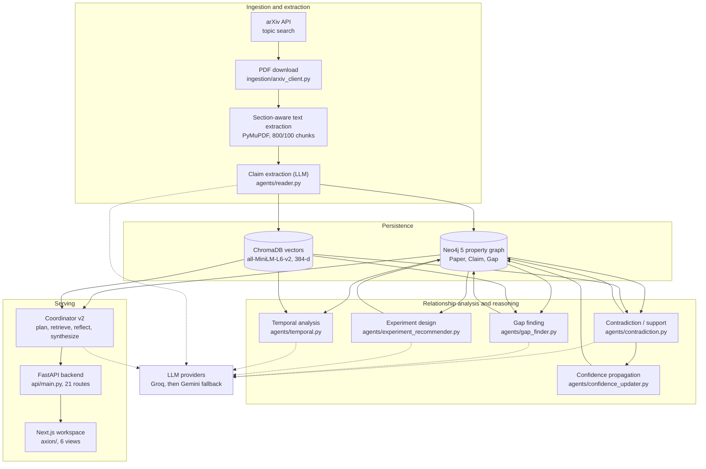

<h1 align="center">
  <br>
  
  <br>
</h1>

**Map the evidence. Trace the disagreements. Investigate what comes next.**

Axion is a research-intelligence platform that turns scientific literature into a
connected graph of **claims**, **supporting evidence**, **contradictions**, and
**research gaps**. It combines structured claim extraction, vector retrieval,
graph relationships, LLM-assisted reasoning, temporal analysis, and experiment
proposals so you can ask what a body of literature actually establishes, where
its findings disagree, and which questions remain open.

Axion is **not** a chatbot over PDFs. Its central design idea is representing
scientific claims and their relationships as inspectable, source-linked graph
data rather than as an opaque document summary.

<p align="center">
  
  
  
  
  
  
  
  
</p>

> **Status:** research prototype / self-hosted MVP in active development. The
> end-to-end loop (ingest → graph → reason → API → UI) runs on a real corpus, but
> several capabilities are experimental and the project is **not production
> ready**. See [Limitations and known issues](#limitations-and-known-issues) and
> [Security considerations](#security-considerations). The full engineering
> inventory lives in [`PROJECT_INFO.md`](./PROJECT_INFO.md).

---

## Table of contents

- [The problem](#the-problem)
- [What is Axion?](#what-is-axion)
- [Core capabilities](#core-capabilities)
- [Architecture](#architecture)
- [How the research pipeline works](#how-the-research-pipeline-works)
- [Product interface](#product-interface)
- [The frontend (axion/)](#the-frontend-axion)
- [Installation and quick start](#installation-and-quick-start)
- [Docker deployment](#docker-deployment)
- [Configuration reference](#configuration-reference)
- [API reference](#api-reference)
- [Example workflows](#example-workflows)
- [Evaluation and testing](#evaluation-and-testing)
- [Limitations and known issues](#limitations-and-known-issues)
- [Security considerations](#security-considerations)
- [Roadmap](#roadmap)
- [Contributing](#contributing)
- [License and acknowledgments](#license-and-acknowledgments)

---

## The problem

Scientific findings are not stored in a form that makes them easy to compare.

- **Findings are distributed.** A single question is answered in fragments
  across dozens of papers, each with its own setup, dataset, and metric.
- **Claims are hard to align.** Two papers can agree on a topic while disagreeing
  on a specific, parameter-scoped finding — and that difference is easy to miss.
- **Conflicts need context.** A result that contradicts another is only
  meaningful alongside its conditions (model scale, dataset, evaluation setting).
- **Provenance gets lost.** Summaries quote conclusions without the paper,
  section, or sentence they came from, so claims cannot be checked.
- **Gaps are buried.** The most useful clues about what is *not* known are
  usually in limitations and future-work sections that nobody reads closely.

Manually synthesizing "what does the field agree on, what is disputed, and what
is untested" takes weeks. Axion does not attempt to replace that judgement or to
settle scientific truth; it tries to make the underlying claims, their sources,
and their possible relationships easier to inspect.

---

## What is Axion?

Axion is a self-hosted application and pipeline that:

1. **Ingests** scientific papers from arXiv (search by topic, download the PDF,
   extract text).
2. **Extracts** atomic, structured claims (subject / metric / direction /
   confidence / evidence span / section) instead of storing opaque text.
3. **Stores** claims in a Neo4j property graph and a ChromaDB vector index.
4. **Retrieves** semantically similar claims and asks an LLM to judge their
   relationship — contradiction, support, or unrelated.
5. **Mines** research gaps from future-work and limitation statements and from
   clusters of related-but-incomplete claims.
6. **Proposes** concrete experiments that could resolve the highest-confidence
   contradictions.
7. **Propagates** confidence across the graph as supporting and contradicting
   edges accumulate.
8. **Answers** research questions with a `plan → retrieve → reflect → synthesize`
   loop that returns a cited report.
9. **Visualises** the graph, contradictions, gaps, timelines, and confidence
   drift in an interactive workspace.

### Document-level Q&A vs. a claim-level graph

This distinction is the core of the project, so it is worth being precise.

| | Document-level Q&A / RAG | Axion |
| :--- | :--- | :--- |
| **Unit of knowledge** | A text chunk or a document | An atomic, structured claim |
| **Retrieval** | Nearest chunks to the question | Nearest claims, plus their graph neighbourhood |
| **Relationships** | Implicit in the text | Explicit typed edges (`CONTRADICTS`, `SUPPORTS`, `RELATED_TO`) |
| **Provenance** | Often a file/page reference | Claim → paper → section → evidence span |
| **Cross-document conflict** | Not represented | First-class `CONTRADICTS` edges with explanations |
| **Persistence** | Usually stateless per query | A growing graph that new papers are compared against |

The value of the graph is that it is *inspectable*: every claim can be traced to
its source, and every relationship is a stored object you can examine, agree
with, or reject — rather than a sentence in an answer.

---

## Core capabilities

Maturity legend: **✅ Implemented** · **🟡 Works with caveats** · **🧪 Experimental**

| # | Capability | Maturity | What it does and why it matters |
| :-: | :--- | :--: | :--- |
| 1 | **arXiv discovery & ingestion** | ✅ | Searches arXiv by topic and downloads PDFs (`ingestion/arxiv_client.py`). arXiv is currently the only supported source. |
| 2 | **Section-aware PDF parsing** | ✅ | PyMuPDF extracts text; a marker-based splitter isolates Abstract, Intro, Results, etc., then chunks at 800 chars with 100-char overlap (`ingestion/pdf_parser.py`). Works on text-layer PDFs; scanned PDFs are unsupported. |
| 3 | **Structured claim extraction** | ✅ | An LLM extracts up to 8 falsifiable claims per paper with optional structured fields (subject, predicate, object, metric, direction, conditions) (`agents/reader.py`). Extraction quality is LLM-dependent. |
| 4 | **Claim provenance & evidence spans** | 🟡 | Claims are linked to paper, section, base confidence, and an evidence span, exposed via `/api/claims/{id}/provenance` (✅). The provenance UI and `/api/claims` subject/metric fields are **not fully surfaced yet** (🟡). |
| 5 | **Neo4j knowledge graph** | ✅ | `Paper`, `Claim`, and `Gap` nodes with typed edges and property indexes (`graph/neo4j_schema.py`, `graph/neo4j_queries.py`). `Benchmark`/`Dataset`/`Method` constraints are declared but **not populated by any code**. |
| 6 | **ChromaDB vector retrieval** | ✅ | Local persistent vectors via `all-MiniLM-L6-v2` (384-dim) for claims and paper chunks (`embeddings/store.py`). Embeddings are local; no embedding API cost. |
| 7 | **Contradiction & support analysis** | 🟡 | Semantic neighbours above a distance threshold are passed to an LLM that labels the relationship and writes an explanation + confidence (`agents/contradiction.py`). These are **LLM-assisted hypotheses, not verified facts**, and are unmeasured (see evaluation). |
| 8 | **Research-gap discovery** | 🟡 | Mines future-work/limitation text and clusters of related claims (`agents/gap_finder.py`). Stored gap confidence is **not persisted** (the API returns `null`), so it is not shown in the UI. |
| 9 | **Experiment proposal generation** | 🟡 | For a contradiction, an LLM designs a minimal resolving experiment (dataset, models, metric, decision rule, cost) stored on the `CONTRADICTS` edge (`agents/experiment_recommender.py`). Feasibility is not validated. |
| 10 | **Graph-based confidence updates** | 🟡 | Recomputes `confidence = base + 0.08·supports − 0.12·contradictions`, clamped to `[0.05, 0.98]` (`agents/confidence_updater.py`). This is a **heuristic score, not a calibrated probability**. |
| 11 | **Multi-step question answering** | 🟡 | Coordinator v2 runs plan → retrieve → reflect (≤3 iterations) → synthesize and returns a cited report (`agents/coordinator_v2.py`, `planner.py`, `reflector.py`, `synthesizer.py`). Runs synchronously in the request; see limitations. |
| 12 | **Temporal analysis & dispute timelines** | 🟡 | Year-filtered retrieval plus LLM narratives for consensus evolution and dispute status (`agents/temporal.py`). Quality depends on having enough claims spread across years. |
| 13 | **Interactive research workspace** | ✅ | A six-view Next.js workspace rendered in the **Cobalt Grid** design language — force-directed graph, contradiction and gap ledgers, timeline, and confidence-evolution views (`axion/`). See [Product interface](#product-interface). |
| 14 | **API & command-line workflows** | ✅ | A FastAPI service (21 routes) plus a `main.py` CLI for batch ingestion and analysis jobs. |

---

## Architecture



### Components and responsibilities

| Component | Path | Responsibility | LLM? |
| :--- | :--- | :--- | :--: |
| arXiv client | `ingestion/arxiv_client.py` | Topic search and PDF download (retry with backoff) | ❌ |
| PDF parser | `ingestion/pdf_parser.py` | Text extraction, section splitting, chunking | ❌ |
| Scheduler | `ingestion/scheduler.py` | Periodic/custom ingestion; overlap guard; run log; **enqueues** when a queue exists | ❌ |
| Job queue | `jobs/` (`backend`, `store`, `tasks`, `worker`) | Durable RQ + Redis queue and worker; in-process threads when Redis is absent | ❌ |
| Progress tracker | `ingestion/progress.py` | Ingestion status and logs for the UI, mirrored through Redis across processes | ❌ |
| Reader | `agents/reader.py` | Structured claim extraction and provenance stamping | ✅ |
| Contradiction agent | `agents/contradiction.py` | Candidate retrieval + relationship adjudication | ✅ |
| Gap finder | `agents/gap_finder.py` | Gaps from future work and claim clusters | ✅ |
| Experiment recommender | `agents/experiment_recommender.py` | Minimal resolving-experiment design | ✅ |
| Confidence updater | `agents/confidence_updater.py` | Heuristic confidence propagation | ❌ |
| Temporal agent | `agents/temporal.py` | Consensus evolution and dispute timelines | ✅ |
| Citation agent | `agents/citation.py` | Semantic Scholar citation counts + weighting helper | ❌ |
| Coordinator v2 | `agents/coordinator_v2.py` (+ `planner`/`reflector`/`synthesizer`) | Multi-step question answering | ✅ |
| Graph layer | `graph/neo4j_client.py`, `neo4j_queries.py`, `neo4j_schema.py` | Driver, Cypher queries, schema setup | ❌ |
| Vector layer | `embeddings/store.py` | ChromaDB collections for claims and chunks | ❌ |
| API | `api/main.py`, `api/models.py` | 22 `/api` routes + `/healthz`, response models | — |
| Frontend | `axion/` | Six-view research workspace (Cobalt Grid design system) | — |
| LLM router | `llm.py` | Provider fallback, transient retry, provider cooldown, optional cache | — |

> The graph store and the vector store are **independent systems kept roughly in
> sync by the ingestion code**. Writing a claim to Neo4j does not guarantee the
> matching vector exists, and consistency is not transactional across the two.

### Technology stack

| Layer | Technology | Notes |
| :--- | :--- | :--- |
| Backend language | Python 3.11 | CI runs on 3.11 |
| API framework | FastAPI + Uvicorn | `fastapi==0.136.3`, `uvicorn[standard]==0.48.0` |
| Validation | Pydantic v2 | `pydantic==2.13.4` |
| Rate limiting | slowapi | global `60/minute` per IP |
| Graph database | Neo4j 5.18 Community | `neo4j==6.2.0` driver; APOC plugin in Compose |
| Vector store | ChromaDB | `chromadb==1.5.9`, local persistent |
| Embeddings | sentence-transformers `all-MiniLM-L6-v2` | 384-dim, runs locally |
| PDF parsing | PyMuPDF | `PyMuPDF==1.27.2.3` |
| LLM SDKs | Groq, Google GenAI, Anthropic | `openai/gpt-oss-20b`, `gemini-3.8-flash`, `claude-sonnet-4-20250514` |
| Background jobs | RQ + Redis, thread fallback | one `worker` sidecar; jobs survive API restarts |
| Scheduling | APScheduler | in-process; enqueues rather than runs when a queue exists |
| Frontend | Next.js 16.2.6, React 19, TypeScript 5.7 | App Router, single route |
| Styling | Tailwind CSS v4 + Cobalt Grid tokens | square-cornered shadcn/ui-style primitives on Radix |
| Typography | Newsreader · Hanken Grotesk · DM Mono | display · interface · technical (`next/font`, system fallbacks) |
| Data fetching | SWR | polling for status/progress |
| Graph rendering | react-force-graph-2d | force-directed canvas, monochrome ink encoding |
| Package manager (web) | pnpm | lockfile committed |

---

## How the research pipeline works

The pipeline mixes **deterministic** operations with **LLM-assisted judgments**
and **heuristic calculations**. They are labelled below so it is clear which
steps can be reproduced exactly and which cannot.

1. **Discover and ingest papers** *(deterministic)* — `search_papers()` queries
   arXiv; `download_pdf()` fetches the PDF with retry/backoff. Existing PDFs are
   reused.
2. **Extract text and sections** *(deterministic)* — PyMuPDF returns page text; a
   marker-based splitter derives sections and `chunk_text()` produces overlapping
   chunks for retrieval.
3. **Extract structured claims** *(LLM-assisted)* — each target section is sent
   to the reader prompt; returned claims are normalised defensively, with a
   20-character minimum. Up to 8 claims per section.
4. **Preserve source and evidence** *(deterministic persistence)* — each claim is
   written to Neo4j with `section`, `base_confidence`, structured fields, and an
   `evidence_span`, linked by an `EXTRACTED_FROM` edge; the same text is embedded
   into ChromaDB with `arxiv_id`/`paper_year` metadata.
5. **Retrieve candidate related claims** *(deterministic)* — for each claim,
   `find_similar_claims()` returns the 8 nearest vectors; only pairs whose cosine
   distance is `≤ CONTRADICTION_MAX_DISTANCE` reach the judge, and same-paper /
   same-claim pairs are skipped. Measured on the current 2,389-claim index with
   `eval/measure_gate.py`: the previous `0.95` threshold let **100 %** of the
   11,602 retrieved pairs through (it was inert), whereas `0.35` passes
   **42.6 %** — 57.4 % fewer LLM judgements — while 80 % of claims still keep at
   least one candidate.
6. **Assess potential relationships** *(LLM-assisted, guarded)* — the candidate
   pair is sent to an LLM that returns `CONTRADICTS`, `SUPPORTS`, or `UNRELATED`
   with an explanation, a confidence value, and a three-part decomposition
   (`same_phenomenon`, `comparable_measurement`, `opposite_outcome`). A
   `CONTRADICTS` verdict is **demoted deterministically** unless all three are
   true, so a confident-but-unjustified call cannot become an edge.
7. **Store graph relationships** *(deterministic)* — non-`UNRELATED` verdicts
   become `CONTRADICTS`/`SUPPORTS` edges with `explanation` and `confidence`.
8. **Discover possible gaps** *(LLM-assisted)* — future-work/limitation sections
   are mined for open questions, and samples of related claims are clustered to
   ask what the cluster circles but never answers. Gaps link to claims via
   `RELATED_TO`.
9. **Propose experiments** *(LLM-assisted)* — for a contradiction, the
   recommender designs a minimal experiment and stores it as JSON on the
   `CONTRADICTS` edge.
10. **Retrieve and reason for a question** *(LLM-assisted)* — Coordinator v2
    plans sub-queries, retrieves claims/contradictions/gaps, reflects on
    sufficiency (score ≥ 7 to stop, max 3 iterations), and synthesizes.
11. **Synthesize an answer** *(LLM-assisted)* — the synthesizer writes a
    structured report (consensus, disputes, gaps, recommended experiments,
    confidence) citing arXiv IDs, which the API returns with its plan,
    reflection log, and sources.

> **Relationship verdicts are hypotheses.** A `CONTRADICTS` edge means an LLM
> judged two claims to conflict given their text — it is a prompt to investigate,
> not proof that either paper is wrong. Confidence values are heuristic scores,
> not calibrated probabilities. Nothing in Axion establishes scientific truth.

---

## Product interface

The frontend is a single-page Next.js workspace rendered in the **Cobalt Grid**
design language — a two-color system of warm cream paper (`#F0EBDE`) and
electric cobalt ink (`#1F2BE0`), a permanent graph-paper grid, square corners,
hairline rules, and three typefaces with distinct roles: **Newsreader** (400)
for display typography, **Hanken Grotesk** for interface copy, and **DM Mono**
for identifiers, metrics, and logs.

There is a navigation rail (with the AXION mark in the top-left corner) and a
`⌘K`/`Ctrl-K` command bar. Six views are switchable with the keyboard keys
`1`–`6` (the digits are no longer displayed in the rail, but the shortcuts
still work) when focus is not in a text field:

| Key | View | What you can do |
| :-: | :--- | :--- |
| 1 | **Research** | Ask a research question and read the synthesized report, execution plan, reflection trace, confidence, and sources. Also shows dashboard stats and browser-local query history. |
| 2 | **Knowledge Graph** | Explore a force-directed canvas of Paper/Claim/Gap nodes with typed edges; adjust how many claims are loaded. |
| 3 | **Contradictions** | Review detected contradictions (both claims, both papers, explanation, confidence) with a minimum-confidence filter, and request an experiment design. |
| 4 | **Research Gaps** | Browse gaps with their related claims and filter by source. |
| 5 | **Timeline** | Enter a topic and year range to see a consensus narrative, current status, and a dispute timeline (resolved vs ongoing). |
| 6 | **Graph Evolution** | See the confidence distribution and the claims whose confidence moved most from their base. |

Additional surfaces: a **dashboard stats** panel fed by `/api/stats`, a global
**status bar** and nav health indicator derived from `/api/health`, and an
**ingestion sheet** for topic-based custom ingestion with live progress and
logs.

Because the whole palette is monochrome, meaning is never carried by color
alone:

- **Confidence** is encoded by fill density plus text: a solid square for high
  (≥ 80%), an outlined square for medium (50–79%), a hatched square for low
  (< 50%) — always alongside the numeric percentage and a `HIGH`/`MEDIUM`/`LOW`
  label.
- **Disputes** use `ONGOING` (outlined) vs `RESOLVED` (filled) chips;
  **ingestion failures** get a hatched `FAILED` treatment.
- In the graph, entity types are distinguished by **shape** (papers = solid
  dots, claims = confidence-density dots, gaps = hollow diamonds) and
  relationship types by **dash pattern and weight** (`CONTRADICTS` = heavy
  solid, `EXTRACTED_FROM` = dashed); the legend swatches match the canvas
  exactly.
- Confidence distribution uses a **pixel-stack** bar of small square cells
  (filled = cobalt, unfilled = faint cobalt) with the count and percentage
  printed next to it.

Motion is restrained (opacity and line-color transitions of ~120–250 ms) and
is disabled under `prefers-reduced-motion`.

Honest notes on current UI behaviour:

- The query view shows a **static list of the pipeline stages** while a job runs.
  The code deliberately does *not* animate completed stages, because the queued
  job reports no per-stage progress — only `queued` → `running` → `completed`.
- Query history is stored in **browser `localStorage` only** — it is not saved
  server-side and is lost across devices.
- There is **no export** (PDF/Markdown/CSV) and **no streaming** of responses.
- There are **no screenshots** committed to this repository, so none are shown
  here. The architecture diagram above is the authoritative visual reference.

---

## The frontend (`axion/`)

A Next.js 16 App Router application (single route, `app/page.tsx`) with React
19, TypeScript, Tailwind CSS v4, and SWR. Package manager is **pnpm**.

```
axion/
├── app/                    # layout, page (shell), globals.css (design tokens), API proxy route
├── components/axion/       # view components: nav rail, command bar, query panel,
│                           # knowledge graph, contradictions, gaps, timeline,
│                           # evolution, ingestion sheet, status bar, stats, experiment card
├── components/cg/          # shared Cobalt Grid primitives (overlines, confidence tags,
│                           # status chips, pixel-glitch / QR-block motifs, empty states)
├── components/ui/          # square-cornered Radix primitives (button, slider, sheet, …)
├── lib/                    # api-client (typed fetch + job polling), hooks, utils
├── types/axion.ts          # API response contracts, mirrored from api/models.py
└── public/                 # brand assets (axion-logo.png lockup, axion-logo-mark.png)
```

- **Design tokens** live in `app/globals.css` (`--cg-*` custom properties) and
  remap the semantic variables used by the UI primitives, so the whole palette
  is controlled from one file.
- **Fonts** are loaded with `next/font/google` and exposed as CSS variables
  (`Newsreader`, `Hanken Grotesk`, `DM Mono`) with sane fallbacks; nothing is
  hidden while fonts load.
- **Write/compute calls** are proxied server-side through
  `app/api/backend/[...path]/route.ts`, which attaches `AXION_API_KEY`; the key
  never reaches the browser. Read-only calls go straight to
  `NEXT_PUBLIC_API_URL`.
- **Brand assets** are derived from `Blueprint AXION Scientific Logo.png` at the
  repository root: the rail shows the cropped mark, and the boot/loading screens
  show the full lockup.

### Running and checking the frontend

```bash
cd axion
pnpm install
pnpm dev                       # http://localhost:3000
pnpm lint                      # ESLint: 0 errors (2 intentional hydration warnings)
pnpm exec tsc --noEmit         # type check
pnpm build                     # production build (runs tsc)
```

**Frontend-only mode:** the workspace runs fine with no backend — every data
view renders an explicit offline/empty state ("Graph unavailable",
"Contradictions unavailable", …), the status bar shows `SYSTEM OFFLINE`, and
dashboard stats show `STATUS: API OFFLINE`. This is an intentional, designed
state, not a broken screen.

Deeper documentation:

- [`FRONTEND_DESIGN_REQUIREMENTS.md`](./FRONTEND_DESIGN_REQUIREMENTS.md) — the
  designer-facing requirements document (tokens, views, states, accessibility).
- [`FRONTEND_HANDOVER.md`](./FRONTEND_HANDOVER.md) — the 18-endpoint API
  contract the frontend talks to.

---

## Installation and quick start

This is a self-hosted, two-part application: a Python/FastAPI backend and a
Next.js frontend. You need a Neo4j instance and **at least one LLM provider key**
to do anything useful — the application cannot run meaningfully with zero
configuration.

### Prerequisites

| Requirement | Version used by the project |
| :--- | :--- |
| Python | 3.11 (3.10+ likely works; CI targets 3.11) |
| Node.js | 20 |
| pnpm | 9 or 10 (via `corepack enable`) |
| Docker + Docker Compose | for Neo4j (or any reachable Neo4j 5.x) |
| LLM provider key | Groq (primary) and/or Google Gemini (fallback) |
| Disk / network | ~300 MB Python deps + local embedding model download on first run |

> ⚠️ **Known packaging gap:** `ingestion/arxiv_client.py` imports the `arxiv`
> package, but `arxiv` is **not currently listed in `requirements.txt`**. A fresh
> install will fail at import until you add it manually with
> `pip install arxiv`. This is tracked as a documentation/dependency fix, not a
> behaviour change.

### 1. Get the repository

The GitHub remote and local folder still carry the project's legacy name
(`AetherGraph` / `schimesh`) pending a rename; the project itself is Axion.

```bash
git clone https://github.com/Som007-builds/AetherGraph.git axion-repo
cd axion-repo
```

### 2. Create a Python environment and install

**Windows PowerShell**

```powershell
python -m venv venv
.\venv\Scripts\Activate.ps1
pip install -r requirements-dev.txt   # includes runtime + test/eval deps
pip install arxiv                     # see packaging-gap note above
```

**macOS / Linux**

```bash
python -m venv venv
source venv/bin/activate
pip install -r requirements-dev.txt
pip install arxiv
```

Use `pip install -r requirements.txt` instead if you only want runtime
dependencies (the `-dev` file adds pytest, httpx, numpy, pandas, scikit-learn).

### 3. Configure environment

```powershell
# Windows PowerShell
Copy-Item .env.example .env
```

```bash
# macOS / Linux
cp .env.example .env
```

Then edit `.env` and set at minimum:

- `GROQ_API_KEY` **and/or** `GEMINI_API_KEY` (the default provider chain is
  `groq → gemini`)
- `NEO4J_PASSWORD` (must match the password Compose uses)
- `AXION_API_KEY` (required to enable the write/compute endpoints — query,
  experiment design, confidence recalculation, ingestion; see
  [Security considerations](#security-considerations)).
  Generate one with `python -c "import secrets; print(secrets.token_urlsafe(36))"`.

See the [configuration reference](#configuration-reference) for every variable.
Never commit `.env`.

### 4. Start Neo4j and initialise the schema

```bash
docker compose up -d neo4j
# wait for the healthcheck to pass, then create constraints/indexes:
python -m graph.neo4j_schema
```

The schema step is idempotent and only needs to run once per database. It
creates unique constraints on `Paper.arxiv_id`, `Claim.claim_id`, and
`Gap.gap_id`, plus indexes on year, section, and confidence fields.

### 5. Start the backend

```bash
python -m uvicorn api.main:app --reload --port 8000
```

- API documentation: <http://localhost:8000/docs>
- Readiness check: <http://localhost:8000/api/health>
- Liveness check: <http://localhost:8000/healthz>

The API boots even when Neo4j or ChromaDB are unreachable: `/healthz` stays
`200` while `/api/health` returns `503` with a degraded status.

### 6. Ingest your first papers (optional but recommended)

Either use the CLI:

```bash
python main.py --mode ingest --query "chain of thought prompting" --n 10
python main.py --mode contradict        # detect relationships + recalc confidence
python main.py --mode gaps              # discover research gaps
```

…or start the backend and use the **Ingestion** sheet in the UI (which needs
`AXION_API_KEY` set on both the backend and the frontend server — the Next.js
proxy attaches it, so it never reaches the browser).

### 7. Start the frontend

Create `axion/.env.local`:

```bash
NEXT_PUBLIC_API_URL=http://localhost:8000
AXION_API_KEY=<same value as AXION_API_KEY in the root .env>
```

```bash
cd axion
pnpm install
pnpm dev
```

Open <http://localhost:3000>. Use the navigation rail, the keyboard keys
`1`–`6`, or `⌘K`/`Ctrl-K` to move between views. Without a backend the
workspace still runs and shows its designed offline states — see
[The frontend](#the-frontend-axion).

### Troubleshooting

| Symptom | Likely cause / fix |
| :--- | :--- |
| `ModuleNotFoundError: No module named 'arxiv'` | The `arxiv` package is not in `requirements.txt`; run `pip install arxiv`. |
| `ServiceUnavailable` / Neo4j connection errors | Neo4j is not up or the password is wrong. Check `docker compose ps`, the `NEO4J_PASSWORD` value, and that the host port is `7887`. |
| UI shows `SYSTEM OFFLINE` / `API OFFLINE` badges | Expected when the backend is not running (or `NEXT_PUBLIC_API_URL` is wrong). Start the API on port 8000 and confirm `/api/health` returns `200`. |
| `/api/health` returns `503` | Neo4j and/or ChromaDB is unreachable. `/healthz` returning `200` is expected even when degraded. |
| First ingestion is slow / downloads a model | sentence-transformers downloads `all-MiniLM-L6-v2` on first use; it needs network access once. |
| LLM calls hang, then fail | The router retries transient 5xx/timeouts briefly, switches providers on rate limits, and **benches** a provider that fails hard for `LLM_PROVIDER_COOLDOWN_SECONDS` (default 300 s). Check your keys and quotas — with every provider exhausted, a job fails rather than hangs. |
| Ingestion/compute endpoints return `503` | `AXION_API_KEY` is unset on the server. The API fails **closed** by design. |
| Compute endpoints return `401` in the UI | The web server's `AXION_API_KEY` does not match the backend's. Set the same value in the root `.env` and `axion/.env.local`. |
| CORS errors in the browser | Add the frontend origin to `ALLOWED_ORIGINS` and restart the API. |
| `pnpm lint` reports hydration warnings | Two intentional `localStorage` hydration effects in `app/page.tsx` and `query-panel.tsx`; kept as warnings. |

---

## Docker deployment

`docker-compose.yml` defines a five-service stack.

| Service | Image / build | Port(s) | Notes |
| :--- | :--- | :--- | :--- |
| `neo4j` | `neo4j:5.18-community` | `127.0.0.1:7887` (Bolt), `127.0.0.1:7474` (Browser) | APOC enabled; password from `NEO4J_PASSWORD`; loopback-bound; healthchecked via `cypher-shell`. |
| `redis` | `redis:7.4-alpine` | `127.0.0.1:6389` | Job queue + shared job records; loopback-bound; healthchecked; `appendonly` off (jobs are recoverable, the graph is the source of truth). |
| `api` | build from root `Dockerfile` | `8000:8000` | Python 3.11-slim, CPU-only PyTorch, pinned `requirements.txt`, **single Uvicorn worker**, `/healthz` healthcheck, mounts `./data`. |
| `worker` | same image as `api` | — | `python -m jobs.worker`; consumes the queue, runs ingestion and research queries. Scale only if the scheduler is disabled. |
| `web` | build from `axion/Dockerfile` | `3000:3000` | Multi-stage Node 20 + pnpm, Next.js **standalone** output, non-root user, healthcheck. |

**Named volumes:** `neo4j_data`, `neo4j_logs`, `hf_cache` (sentence-transformers
model cache). The `api` service bind-mounts `./data` so ChromaDB vectors and
downloaded PDFs persist on the host.

**Build-time environment (frontend):** only `NEXT_PUBLIC_API_URL` is inlined into
the client bundle at build time (via Compose `build.args`); changing it requires
rebuilding the `web` image, not just restarting it. **Never** pass secrets as
`NEXT_PUBLIC_*` build args — they end up readable by every visitor.

**Runtime secrets (server-side only):** the `api` service reads `AXION_API_KEY`
to authorize write/compute endpoints, and the `web` service reads the same value
plus `AXION_API_URL` (the internal `http://api:8000` address) to proxy those
calls. Neither value reaches the browser.

### Start and stop

```bash
cp .env.example .env      # fill in keys/secrets first
docker compose up --build # start the full stack
docker compose down       # stop (keeps volumes)
docker compose down -v    # stop and delete volumes (destroys the graph)
```

Endpoints: frontend <http://localhost:3000>, API docs
<http://localhost:8000/docs>, Neo4j Browser <http://localhost:7474>.

### Logs and inspection

```bash
docker compose ps
docker compose logs -f api        # backend
docker compose logs -f web        # frontend
docker compose logs -f neo4j      # database
```

### Troubleshooting startup

- **`api` restarts repeatedly** — check `docker compose logs api`; missing LLM
  keys or a Neo4j password mismatch will surface there. The `api` service waits
  for the `neo4j` healthcheck before starting.
- **Frontend cannot reach the API** — confirm `NEXT_PUBLIC_API_URL` was set before
  `docker compose build web`; a value baked into a stale image will not update on
  restart.
- **Ingestion/compute calls return `401` or `503`** — set `AXION_API_KEY` in `.env`
  (both the `api` and `web` services read it) and rebuild/restart the stack.
- **Jobs stay `queued` forever** — the worker is not consuming: check
  `docker compose logs worker` and run `python scripts/queue_smoke.py` (submits a
  query and reports whether the worker claims it). The worker needs `REDIS_URL`
  and prints `*** Listening on axion` when healthy. A job left `running` after a
  hard kill is retried by RQ when the worker comes back.
- **Port conflicts** — the stack uses host ports `7887`, `7474`, `8000`, `6389`,
  and `3000`; adjust the mappings if any are taken.

> **Verified:** the full stack builds and runs — `axion_neo4j`, `axion_redis`,
> `axion_api`, `axion_worker`, and `axion_web` all report healthy; the graph
> survives restarts; a research query is accepted by the API (`202`), executed by
> the **separate worker process**, and its status observed changing from `queued`
> to `running` via `GET /api/jobs/{id}`; and the same flow works through the
> frontend proxy. This is still **not** a production deployment: there is no
> reverse proxy, TLS, or per-user authentication. The single shared
> `AXION_API_KEY` gates write/compute endpoints; add a real identity layer before
> exposing the app to untrusted users.

---

## Configuration reference

All variables are read from `.env` (loaded by `config.py` / `python-dotenv`).
"Frontend build" means the value is inlined by Next.js at build time and is
**visible in the browser**.

| Variable | Purpose | Default | Required | Scope |
| :--- | :--- | :--- | :--: | :--- |
| `GROQ_API_KEY` | Groq LLM key (primary provider) | — | Recommended | Backend |
| `GEMINI_API_KEY` | Google Gemini key (fallback provider) | — | Recommended | Backend |
| `ANTHROPIC_API_KEY` | Anthropic key (available, not in default chain) | — | No | Backend |
| `LLM_CACHE_ENABLED` | Cache identical LLM prompts in-process | `false` | No | Backend |
| `NEO4J_URI` | Bolt URI for Neo4j | `bolt://localhost:7887` | No | Backend |
| `NEO4J_USERNAME` | Neo4j username (`NEO4J_USER` also accepted) | `neo4j` | No | Backend |
| `NEO4J_PASSWORD` | Neo4j password | — | **Yes** | Backend + Compose |
| `NEO4J_CONTAINER_NAME` | Container name used by the backup utility | `axion_neo4j` | No | Backend |
| `ALLOWED_ORIGINS` | Comma-separated CORS allow-list | `http://localhost:3000,http://localhost:5173` | No | Backend |
| `SCHEDULER_ENABLED` | Run periodic ingestion inside the API process | `false` | No | Backend (single worker) |
| `SCHEDULER_INTERVAL_HOURS` | Scheduler cadence in hours | `6` | No | Backend |
| `SCHEDULER_PAPERS_PER_RUN` | Papers fetched per topic per run | `5` | No | Backend |
| `REDIS_URL` | Redis used for the durable job queue and cross-process progress; empty ⇒ in-process thread pool | — (empty) | No | Backend + worker |
| `JOB_TTL_SECONDS` | How long a finished job record is kept | `86400` | No | Backend + worker |
| `JOB_TIMEOUT_SECONDS` | Per-job timeout handed to the queue | `1800` | No | Backend + worker |
| `CONTRADICTION_MAX_DISTANCE` | Max cosine distance for a claim pair to reach the LLM judge | `0.35` | No | Backend |
| `GEMINI_MODEL` | Gemini model id | `gemini-3.8-flash` | No | Backend |
| `GEMINI_THINKING_BUDGET` | Gemini thinking-token budget (`0` disables it) | `0` | No | Backend |
| `LLM_PROVIDER_COOLDOWN_SECONDS` | How long a hard-failing provider is benched | `300` | No | Backend |
| `AXION_API_KEY` | Shared secret for write/compute endpoints (`X-API-Key`); empty ⇒ those endpoints return `503` | — (empty) | **Yes** for query/ingestion | Backend + web server |
| `TRIGGER_SECRET` | Legacy alias still accepted via `X-Trigger-Secret` on ingestion triggers | — (empty) | No | Backend |
| `AXION_API_URL` | Backend address used by the Next.js server-side proxy | `http://localhost:8000` | In Compose | Web server |
| `LOG_LEVEL` | Logging level (`INFO`, `DEBUG`, …) | `INFO` | No | Backend |
| `LOG_FORMAT` | `text` or `json` structured logging | `text` | No | Backend |
| `HF_HOME` | Hugging Face cache dir (set to a volume in Compose) | — | No | Backend / container |
| `NEXT_PUBLIC_API_URL` | Base URL the browser uses to reach the API | `http://localhost:8000` | **Yes** | Frontend **build** |

> ⚠️ **`NEXT_PUBLIC_*` values are public.** Next.js inlines them into the
> JavaScript bundle served to every visitor, so they are **not secret**. Secrets
> must live in server-only variables (`AXION_API_KEY`, `TRIGGER_SECRET`) and be
> attached by the frontend's server-side proxy at
> `axion/app/api/backend/[...path]/route.ts`.

Non-environment settings live in `config.py`: the embedding model
(`all-MiniLM-L6-v2`), `CHUNK_SIZE=800`, `CHUNK_OVERLAP=100`,
`MAX_CLAIMS_PER_PAPER=8`, `LLM_PROVIDER` / `LLM_PROVIDER_CHAIN`, and the five
default `SCHEDULER_TOPICS` (all LLM-related). Everything else — including
`CONTRADICTION_MAX_DISTANCE`, `REDIS_URL`, `GEMINI_MODEL` and the job timeouts —
is an `.env` value listed in the table above.

---

## API reference

Base URL is whatever `NEXT_PUBLIC_API_URL` (frontend) or the API host points to.
Interactive OpenAPI documentation is generated automatically at **`/docs`**
(Swagger UI), with ReDoc at **`/redoc`** and the raw schema at
**`/openapi.json`**. Request/response models are defined in `api/models.py`.

Read-only routes are **unauthenticated**. Everything that spends LLM tokens,
mutates the graph, or submits/follows a background job requires the shared
`AXION_API_KEY`; if the key is unset those routes fail closed with `503` (see
[Security considerations](#security-considerations)).

### Health and status

| Method | Path | Description | Auth |
| :--- | :--- | :--- | :--: |
| GET | `/healthz` | Liveness probe; always `200` while the process serves | — |
| GET | `/api/health` | Readiness; `503` if Neo4j or ChromaDB is unreachable | — |
| GET | `/api/metrics` | In-memory metrics summary (LLM calls, ingestion, writes, cache) | — |
| GET | `/api/stats` | Graph counts: papers, claims, contradictions, gaps, experiments | — |

### Research queries and background jobs

Long work is **never** run inline on the request thread: the API creates a job
record, hands it to the queue, and returns immediately with `202 Accepted`.

| Method | Path | Description | Auth | Rate limit |
| :--- | :--- | :--- | :--: | :--- |
| POST | `/api/query` | Submit Coordinator v2 (≤ 500 chars) → `202 {job_id, status, backend}` | 🔑 | 10/min |
| GET | `/api/jobs/{job_id}` | Poll one job (`queued`/`running`/`completed`/`failed` + result) | 🔑 | — |
| GET | `/api/jobs` | Most recent jobs, newest first | 🔑 | — |

### Claims and provenance

| Method | Path | Description | Auth |
| :--- | :--- | :--- | :--: |
| GET | `/api/claims` | List claims (`limit`, `offset`) | — |
| GET | `/api/claims/{claim_id}/provenance` | Full provenance chain for one claim | — |

### Contradictions and experiments

| Method | Path | Description | Auth | Rate limit |
| :--- | :--- | :--- | :--: | :--- |
| GET | `/api/contradictions` | All contradictions (`min_confidence`, `limit`) | — | — |
| GET | `/api/experiments/{contradiction_id}` | Retrieve a stored experiment design | — | — |
| POST | `/api/experiments/{contradiction_id}/design` | Design and store an experiment on demand | — | 5/min |

### Research gaps

| Method | Path | Description | Auth |
| :--- | :--- | :--- | :--: |
| GET | `/api/gaps` | List gaps, optionally `?source=` filtered | — |

### Temporal analysis

| Method | Path | Description | Auth |
| :--- | :--- | :--- | :--: |
| GET | `/api/temporal/evolution` | Consensus evolution for a `topic` and year range | — |
| GET | `/api/temporal/disputes` | Dispute timeline for a `topic` | — |

### Confidence analysis

| Method | Path | Description | Auth | Rate limit |
| :--- | :--- | :--- | :--: | :--- |
| GET | `/api/confidence/distribution` | Confidence histogram (high/medium/low) | — | — |
| GET | `/api/confidence/most-changed` | Claims whose confidence moved most (`limit`) | — | — |
| POST | `/api/confidence/recalculate` | Recompute confidence for all claims | — | 2/min |

### Ingestion

| Method | Path | Description | Auth | Rate limit |
| :--- | :--- | :--- | :--: | :--- |
| GET | `/api/ingestion/status` | Last run summary and running flag | — | — |
| GET | `/api/ingestion/progress` | Live custom-ingestion progress and logs | — | — |
| POST | `/api/ingestion/trigger` | Enqueue one ingestion cycle → `202` | 🔑 | 2/min |
| POST | `/api/ingestion/custom` | Enqueue `{"topic", "limit"}` ingestion (1–50) → `202` | 🔑 | 5/min |

### Graph access

| Method | Path | Description | Auth |
| :--- | :--- | :--- | :--: |
| GET | `/api/graph` | Nodes and edges for the graph canvas (`limit_claims`) | — |

🔑 = requires an `X-API-Key` header equal to `AXION_API_KEY`. If
`AXION_API_KEY` is unset, these endpoints return `503` (fail-closed). The legacy
`X-Trigger-Secret` header (`TRIGGER_SECRET`) is still accepted. A global
rate limit of `60/minute` per client IP applies to all routes, with the tighter
per-route limits noted above.

> **Security model:** read-only endpoints are public; everything that spends LLM
> tokens or mutates the graph requires the shared API key. The key is held by the
> frontend **server** and attached by its proxy, never shipped to the browser. It
> is still a single shared secret: there is **no per-user identity or
> authorization**. Do not expose the API to a network you do not trust. See
> [Security considerations](#security-considerations).

---

## Example workflows

These describe how someone would actually use Axion. They are illustrative, not
benchmark results.

### Explore a research topic

1. Ingest a handful of papers: `python main.py --mode ingest --query "in-context learning large language models" --n 10`.
2. Run `python main.py --mode contradict` to build relationship edges and
   recalculate confidence.
3. In the **Research** view, ask a question such as *"What does the literature
   say about how model scale affects chain-of-thought reasoning?"* and read the
   synthesized report, its execution plan, and the cited sources.

The report distinguishes consensus from disputes and lists remaining gaps; every
consensus point should cite at least one arXiv ID.

### Investigate two potentially conflicting findings

1. Open the **Contradictions** view and raise the minimum-confidence filter to
   focus on stronger signals.
2. For a suspicious pair, click **Design experiment** to get a proposed minimal
   test (dataset, models, metric, decision rule, and caveats).
3. Treat the verdict as a **hypothesis to check**, not a conclusion — read the
   explanation and both claims, then verify against the source papers.

### Trace a claim back to its source

- `GET /api/claims/{claim_id}/provenance` returns the claim text, `evidence_span`,
  `section`, structured fields, and the source paper (title, authors, published
  date, arXiv URL). The API response includes an
  `https://arxiv.org/abs/<arxiv_id>` link for the paper.

### Review potential research gaps

- Open the **Research Gaps** view (or `GET /api/gaps`) and filter by `semantic`
  or `llm_synthesized`. Gaps are LLM-derived suggestions mined from limitations
  and clusters; read the related claims before treating a gap as real.
  Note that gap confidence is currently not persisted, so it is not displayed.

### Request an experiment proposal

- From a contradiction, `POST /api/experiments/{contradiction_id}/design` designs
  and stores an experiment, or `GET /api/experiments/{contradiction_id}` retrieves
  a previously designed one. The CLI equivalent is `python main.py --mode experiments`.

### Ask the API directly

Both examples enqueue work: the response is `202` with a `job_id`, and the result
is fetched by polling the job.

```bash
# 1. submit
curl -X POST http://localhost:8000/api/query \
  -H "Content-Type: application/json" \
  -H "X-API-Key: $AXION_API_KEY" \
  -d '{"question": "Do larger models benefit more from chain-of-thought prompting?"}'
# {"job_id":"b0fae4af…","status":"queued","backend":"rq"}

# 2. poll until finished
curl http://localhost:8000/api/jobs/b0fae4af… -H "X-API-Key: $AXION_API_KEY"
```

Triggering a custom ingestion (same key, same `202` + job id shape):

```bash
curl -X POST http://localhost:8000/api/ingestion/custom \
  -H "Content-Type: application/json" \
  -H "X-API-Key: $AXION_API_KEY" \
  -d '{"topic": "instruction tuning language models", "limit": 5}'
```

Job records are shared through Redis, so `GET /api/jobs/{id}` works from any API
process and survives an API restart; RQ also retries a job whose worker was
killed mid-flight. Without `REDIS_URL` the same API works in-process, but jobs
are lost on restart.

---

## Evaluation and testing

### Test suite

| Item | State |
| :--- | :--- |
| Offline suite | **229 passed, 12 deselected** (as of the last recorded full run; CI re-runs it on every push) |
| Integration tests | `tests/test_neo4j.py`, `tests/test_claims.py` need a live Neo4j/ChromaDB; marked `integration` and excluded by default |
| CI | `.github/workflows/ci.yml` runs the offline backend suite and a frontend production build on every push/PR to `main` |
| Coverage | Not measured |
| Frontend checks | `pnpm lint`: 0 errors, 2 intentional hydration warnings in `app/page.tsx` / `query-panel.tsx` · `pnpm exec tsc --noEmit`: pass · `pnpm build`: pass (last verified for the Cobalt Grid revision) |

Run the offline tests (no Neo4j, ChromaDB, Redis, or LLM required):

```bash
pytest                       # offline suite
pytest -m integration        # opt-in: requires live Neo4j / ChromaDB
```

### Evaluation harness

The harness lives in `eval/` with a single entry point:

```bash
python eval/run_eval.py --predictor majority                        # offline smoke run (used by CI)
python eval/run_eval.py --predictor random --seed 7
python eval/run_eval.py --predictor llm --dataset axion_pairs.csv   # needs LLM quota + network
```

It evaluates `agents/contradiction.check_pair` on labelled claim pairs and writes
`eval/results/<predictor>_<dataset>.json` with accuracy, **macro F1** (the
headline metric), weighted F1, per-class precision/recall/F1, a confusion matrix,
latency stats, dataset composition, and explicit `warnings`. Full details are in
[`eval/README.md`](./eval/README.md).

### The current dataset: `axion_pairs.csv`

`eval/Data/axion_pairs.csv` is the reviewed set the harness reports on — 286
cross-paper pairs that the production agent would actually score:

| CONTRADICTS | SUPPORTS | UNRELATED |
| ---: | ---: | ---: |
| 4 | 11 | 271 |

Recorded baselines (`eval/results/`, 2026-08):

| predictor | accuracy | macro F1 | CONTRADICTS P / R |
| :--- | ---: | ---: | ---: |
| majority (all `UNRELATED`) | 0.9476 | 0.3244 | 0.00 / 0.00 |
| random (fixed seed) | 0.3706 | 0.2191 | 0.13 / 0.38 |
| LLM (`llm_axion_pairs_prefix_baseline.json`) | 0.8427 | 0.4822 | 0.15 / 0.50 |

The `CONTRADICTS` class is thin: **4 positive pairs** make its precision and recall
noisy, so every `CONTRADICTS` figure below is indicative, not measured. The older
`train.csv` / `val.csv` / `test.csv` splits are obsolete — their positives are
same-paper pairs the agent refuses to score, and `eval/Data/Labeled_pairs.csv` is
0 bytes, so they cannot be regenerated — and are kept for history only.

### The retrieval gate is measured; the judge is not (yet)

The two halves of contradiction detection need two different measurements:

- **Candidate retrieval is deterministic and measured.** `eval/measure_gate.py`
  (offline: no LLM, no writes) replays the production top-8 search over all 2,389
  claims and reports, for a range of gate values, how many of the 11,602 unique
  neighbour pairs would reach the judge. The previous value (`0.95`) passed
  **100 %** of them — the gate was inert; the current
  `CONTRADICTION_MAX_DISTANCE=0.35` passes **42.6 %** (57.4 % fewer judge calls)
  while 80 % of claims still keep at least one candidate. Pair distances: min
  0.000, p50 0.379, p90 0.538, p99 0.652, max 0.769.
- **The LLM judge itself is not measured on the new prompt yet.** That needs a
  full `--predictor llm` run, which requires provider quota. The run is currently
  **blocked**: the free tiers allow 200,000 Groq tokens/day and **20
  `gemini-3.8-flash` requests/day**, both exhausted. No post-change LLM metrics
  are claimed anywhere in this document. The code-level changes (stricter prompt
  with a worked example, three-part decomposition guard, distance gate) are
  described under [How the research pipeline works](#how-the-research-pipeline-works),
  covered by unit tests, and sanity-checked by a hand-built 6-pair probe with 6/6
  agreement.

### What a valid evaluation requires

A meaningful benchmark needs **more reviewed positives** — 4 `CONTRADICTS` pairs
cannot support a precision claim — and a paid (or generously limited) LLM key so
the full set can be re-run after any prompt change. Until then, report `f1_macro`
(rather than accuracy), always print the class mix and `warnings`, and never cite
a single run as proof of quality. Proposed (currently unverified) targets are
documented in `eval/README.md`: macro F1 ≥ 0.55 and `CONTRADICTS` recall ≥ 0.60.

---

## Limitations and known issues

Axion is a working prototype, not a finished product. The following are known and
deliberately not hidden.

### Correctness and evaluation

- **No trustworthy production-aligned contradiction evaluation.** The reviewed
  set (`axion_pairs.csv`) has only **4 `CONTRADICTS` pairs**, and the post-change
  LLM run is blocked on provider quota — so precision and recall for that class
  are indicative at best (details in
  [Evaluation and testing](#evaluation-and-testing)).
- **LLM relationship judgments can be wrong.** Complementary findings can be
  flagged as contradictions when parameter scopes differ. Mitigations are in
  place and covered by tests — a stricter prompt, a deterministic
  three-part-decomposition guard that demotes unjustified `CONTRADICTS` calls,
  and a distance gate — but they reduce, not eliminate, false positives.
  `check_pair()` still returns `None` for `UNRELATED`, same-paper pairs, and
  parse failures alike; callers that pass the optional `diagnostics` dict can
  tell them apart (the contradiction run records per-verdict flags), while the
  eval harness does not separate them yet.
- **Confidence is heuristic, not calibrated.** `base + 0.08·supports −
  0.12·contradictions` is a simple propagation rule, not a probability. The
  citation-weighting helper exists but is not part of the default confidence path.
- **Gap confidence is not stored**, so it is unavailable in the API and UI.
- **No human-in-the-loop correction.** Users cannot accept, reject, or edit a
  claim, contradiction, or experiment, and no feedback is fed back into the system.
- **`Benchmark`/`Dataset`/`Method` nodes are declared but never populated**, and
  there is no community detection or graph summarisation.

### Platform and engineering

- **No per-user authentication or multi-tenancy.** A single shared
  `AXION_API_KEY` gates all write/compute endpoints. There are no accounts,
  roles, quotas, or per-user isolation.
- **Job durability depends on Redis.** With `REDIS_URL` set, job records live in
  Redis (TTL-bounded) and a crash of the API or the worker does not lose them;
  without it the API falls back to an in-process thread pool whose jobs die with
  the process. Metrics and scheduler state remain process-local, and exactly one
  process may run ingestion (the scheduler enqueues when a queue exists).
- **Long-running queries are queued, not streamed.** `/api/query` returns a job
  id immediately (`202`) and the client polls `GET /api/jobs/{id}`. The job still
  runs the full multi-iteration LLM loop, and LLM back-off can sleep up to 300 s
  per attempt, so a query can take minutes; progress is reported at the job level
  only (`queued` → `running` → `completed`/`failed`), not per pipeline stage.
- **Incomplete observability and operations.** Metrics are in-memory and reset on
  restart; there is no tracing, alerting, or persistent metrics store. Neo4j
  backups are a **host-side utility that shells out to Docker** and are not
  scheduled in Compose.
- **Ad-hoc migrations.** Schema changes are handled by `graph/migrate_*.py` and
  `graph/fix_*.py` scripts with no migration framework or log.
- **Ingestion source limits.** arXiv only; no non-English handling and no
  cross-source deduplication (papers are merged by `arxiv_id`).
- **Packaging gaps.** `arxiv` is missing from `requirements.txt`; a fresh install
  needs it added manually. There is no Python version marker and dependencies are
  pinned by version but not by hash.

### Frontend and documentation

- Query history is browser-local only; there is no export, no streaming, and no
  live per-stage progress during a query.
- There is no view-level automated testing, and no screenshots are committed.
- Legacy Streamlit/pyvis/plotly dependencies remain in `requirements.txt` even
  though the Streamlit UI was retired.
- Documentation and branding have historically been inconsistent (legacy names
  SciMesh/AetherGraph) and some side documents lag the code; `PROJECT_INFO.md` is
  the authoritative inventory.

---

## Security considerations

**Axion still needs hardening before it is safe to expose to the public
internet.** What exists today:

- **Shared-key authentication on write/compute endpoints.** `/api/query`,
  `/api/experiments/{id}/design`, `/api/confidence/recalculate`, the ingestion
  triggers, and job polling (`GET /api/jobs…`) require
  `X-API-Key: $AXION_API_KEY` and fail closed (`503`) when the key is unset.
  Read-only endpoints stay public. The legacy `X-Trigger-Secret` header is still
  accepted.
- **The key is server-side only.** The browser calls a Next.js route handler
  (`/api/backend/...`) that attaches the key; it is never inlined into the client
  bundle.
- **No per-user identity.** One shared secret for everyone: no user accounts,
  roles, quotas, or per-user rate limits.
- **No TLS / reverse proxy.** Traffic is plain HTTP.
- **Secrets live in a plaintext `.env`.** There is no secret manager.
- **Neo4j is bound to `127.0.0.1`** in Compose, and **APOC is unrestricted**
  (`apoc.*`) inside the database.
- **Global rate limiting only** (60/min per IP) plus a few tighter route limits;
  there is no per-user limiting or abuse protection.
- **Generic error bodies.** Internal exceptions are logged server-side and
  returned as a generic `500 {"error": "Internal server error"}`.

Practical guidance:

1. **Do not expose the API publicly** as-is. Keep it on localhost or a trusted
   private network.
2. **Never commit `.env`** or any credentials. `.env` and `.env.*.local` are
   gitignored — keep it that way.
3. **Keep privileged secrets out of client-side code.** Anything prefixed
   `NEXT_PUBLIC_` is browser-visible and must never be a privileged secret.
4. **Rotate any credentials that may have been exposed** (LLM API keys, the Neo4j
   password, and `AXION_API_KEY`), especially before archiving or publishing
   the repository.
5. **Restrict network access to databases and internal services.** Keep Neo4j and
   ChromaDB off untrusted networks and restrict APOC where possible.
6. **Add TLS and a real identity layer** (accounts, sessions, per-user quotas)
   before any shared or multi-user deployment.

---

## Roadmap

This roadmap reflects the repository's actual state: implemented and planned
work are separated explicitly. Ordering prioritizes correctness and safety over
new features.

**Implemented**

- [x] End-to-end ingestion → graph → reasoning → API → UI loop
- [x] Claim extraction with provenance; Neo4j + ChromaDB persistence
- [x] Contradiction/support detection, gap discovery, experiment design
- [x] Confidence propagation and temporal analysis
- [x] Coordinator v2 (plan → retrieve → reflect → synthesize)
- [x] Six-view Next.js workspace with keyboard navigation, rebuilt on the Cobalt Grid design system
- [x] Offline test suite (229 passing) and CI for backend tests + frontend build
- [x] Dockerfiles, full-stack Compose, healthchecks, `/healthz` liveness
- [x] Shared-key auth on write/compute routes; job polling is key-guarded too
- [x] Durable job queue (RQ + Redis) with `202` + `GET /api/jobs/{id}` polling
- [x] MIT license

**Planned / in progress**

1. **Production-aligned evaluation** — the harness, dataset, and baselines exist
   (`eval/`), but `axion_pairs.csv` holds only 4 reviewed `CONTRADICTS` pairs, so
   per-class numbers are noisy; the post-change end-to-end run is currently
   **blocked on provider quota** (Groq 200k tokens/day, Gemini 20 requests/day on
   the free tier).
2. **Claim quality and evidence-aware adjudication** — make parse failures
   distinguishable from genuine negatives and improve structured extraction.
3. **Researcher verification and correction workflows** — let users accept,
   reject, or edit claims, relationships, and experiments, and feed that back.
4. **Real authentication and authorization** — per-user identity, roles, and
   quotas to replace the single shared `AXION_API_KEY`.
5. **Observability, backups, and migration discipline** — persistent metrics,
   tracing, alerting; scheduled backups; a real migration framework.
6. **Frontend correctness** — the workspace is redesigned and lint/type/build
   clean; what remains is view-level test coverage and committed screenshots.

---

## Contributing

Contributions are welcome. There is **no formal governance process, code of
conduct, or contributor policy** in this repository yet, so the workflow is kept
deliberately lightweight:

1. **Fork and branch.** Create a focused branch from `main`
   (e.g. `fix/confidence-clamp`, `docs/readme`).
2. **Install dependencies** as in [Installation and quick start](#installation-and-quick-start)
   (use `requirements-dev.txt`, and add `arxiv` if needed).
3. **Run the tests** before and after your change:
   ```bash
   pytest                 # offline suite must stay green
   ```
4. **For frontend changes:** work inside `axion/` and keep edits consistent with
   the Cobalt Grid token system in `app/globals.css` — square corners, the
   two-color rule (`#F0EBDE` paper / `#1F2BE0` ink), no shadows/gradients, and
   monochrome status encodings. Verify with
   ```bash
   cd axion && pnpm lint && pnpm exec tsc --noEmit && pnpm build
   ```
5. **Make a focused change.** Keep pull requests scoped to one concern and
   consistent with the existing structure, naming, and style.
6. **Include tests where applicable**, especially for backend logic.
7. **Open a pull request** with a clear description of what changed, why, and how
   you verified it. Note any behaviour change and any new configuration.

Good first areas: adding the missing evaluation dataset, improving structured
claim extraction, wiring the provenance and metrics endpoints into the UI, and
documentation accuracy. If you plan a large change, please open an issue first to
discuss the approach.

---

## License and acknowledgments

This project is licensed under the **MIT License** — see [`LICENSE`](./LICENSE).
Copyright © 2026 Soham Singh.

Axion builds on open-source and hosted components it does not claim ownership of:
[FastAPI](https://fastapi.tiangolo.com/), [Neo4j](https://neo4j.com/),
[ChromaDB](https://www.trychroma.com/),
[sentence-transformers](https://www.sbert.net/) (`all-MiniLM-L6-v2`),
[PyMuPDF](https://pymupdf.readthedocs.io/), and
[Next.js](https://nextjs.org/)/[React](https://react.dev/)/[Tailwind CSS](https://tailwindcss.com/).
LLM inference is provided by the [Groq](https://groq.com/),
[Google Gemini](https://ai.google.dev/), and
[Anthropic](https://www.anthropic.com/) APIs, and citation counts by
[Semantic Scholar](https://www.semanticscholar.org/).

---

## Closing

Scientific literature is a graph of claims, not a pile of documents — and the
questions that matter most often live in the disagreements and the omissions.
Axion's goal is to make those claims, their sources, and their possible
relationships inspectable, so that researchers and engineers can decide for
themselves what the evidence supports and what still needs to be tested.

The most valuable contributions right now are the unglamorous ones: a valid
cross-paper evaluation dataset, honest correctness work on claim extraction, real
security for multi-user use, and operational durability. If that is the kind of
work you find interesting, you are in the right place.
